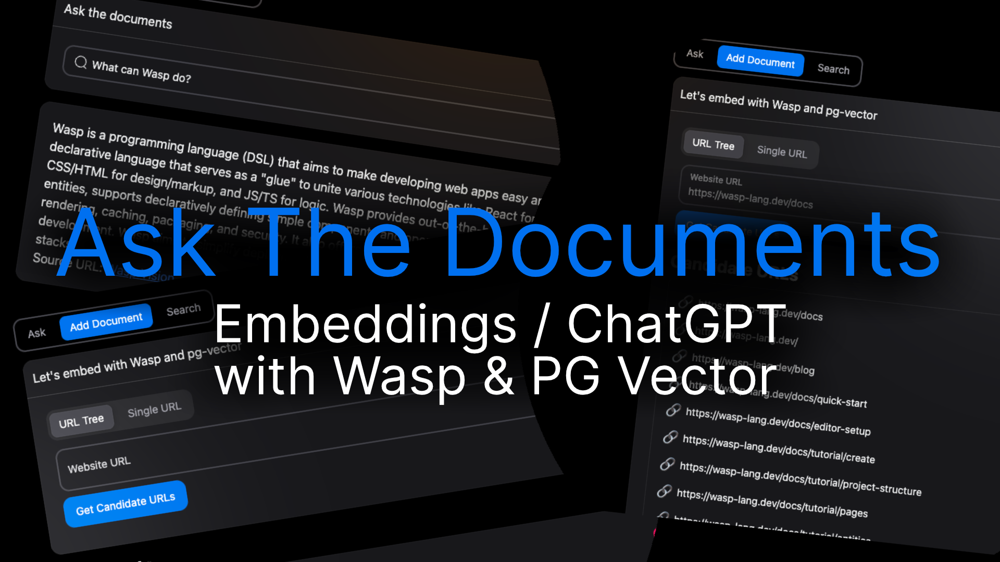

# Ask The Documents (Embeddings / RAG / ChatGPT) with Wasp & PG Vector



Live on [Fly](https://ask-the-documents-client.fly.dev/) and [Railway](https://ask-the-documents-client.up.railway.app/).

## What does it do?

This is an example Wasp app that supports:

- scraping whole link hierarchies (great for docs)
- scraping a single link
- generating embeddings for page content
- semantic search using PG Vector
- chatting with the documents using OpenAI's ChatGPT

## Running it locally

1. Install the project dependencies, which include Wasp:

   ```bash
   npm install
   ```

2. Start the database with:

   ```bash
   npm run wasp -- start db --db-image pgvector/pgvector:pg18
   ```

3. Copy `.env.server.example` to `.env.server` and fill out the environment variables.

   ```bash
   OPENAI_API_KEY="<your_openai_key>"
   GOOGLE_CLIENT_ID="<your_google_client_id>"
   GOOGLE_CLIENT_SECRET="<your_google_client_secret>"
   ```

4. Migrate the database with:

   ```bash
   npm run wasp -- db migrate-dev
   ```

5. Start the server with:

   ```bash
   npm run dev
   ```

### Installing on the `main` branch

<!-- TODO(#2262): Remove this section once the examples join the pnpm workspace. -->

On `main`, this example depends on the unreleased Wasp in this repo, so `npm install` fails. Build Wasp from source instead (see [`waspc/README.md`](../../waspc/README.md)), and then install against it from this directory:

```sh
mise run build
mise run reinstall-dev-wasp-app-deps
```
