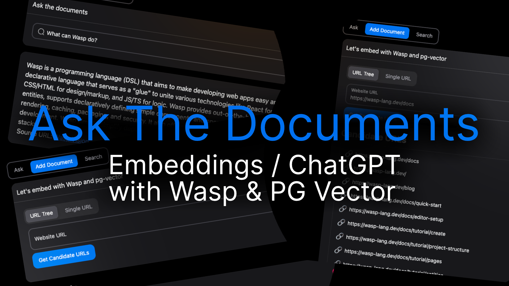

# Ask The Documents (Embeddings / RAG / ChatGPT) with Wasp & PG Vector



Live on [Fly](https://ask-the-documents-client.fly.dev/) and [Railway](https://ask-the-documents-client.up.railway.app/).

## What does it do?

This is an example Wasp app that supports:

- scraping whole link hierarchies (great for docs)
- scraping a single link
- generating embeddings for page content
- semantic search using PG Vector
- chatting with the documents using OpenAI's ChatGPT

## Running it locally

1. Make sure you have the latest version of Wasp installed.

   ```bash
   npm i -g @wasp.sh/wasp-cli@latest
   ```

2. Install the project dependencies:

   ```bash
   wasp install
   ```

3. Start the database with:

   ```bash
   wasp start db --db-image pgvector/pgvector:pg18
   ```

4. Copy `.env.server.example` to `.env.server` and fill out the environment variables.

   ```bash
   OPENAI_API_KEY="<your_openai_key>"
   GOOGLE_CLIENT_ID="<your_google_client_id>"
   GOOGLE_CLIENT_SECRET="<your_google_client_secret>"
   ```

5. Migrate the database with:

   ```bash
   wasp db migrate-dev
   ```

6. Start the server with:

   ```bash
   wasp start
   ```

## Deploying to Railway

Use the release tag matching your Wasp CLI version to update the existing deployment:

```bash
wasp install
wasp deploy railway deploy ask-the-documents --existing-project-id d5be4f30-4193-4c2e-9f0c-fa9444654693
```

The production services are `ask-the-documents-server` and `ask-the-documents-client`. Configure server secrets on `ask-the-documents-server`. Google OAuth must allow `https://ask-the-documents-server.up.railway.app/auth/google/callback` as a redirect URI.

The **Release - Deploy examples** workflow deploys to both providers. Its Railway job uses the `examples/ask-the-documents-railway-production` GitHub environment and requires the `RAILWAY_GITHUB_PRODUCTION_TOKEN` account-token secret. Run it from the matching release tag.
