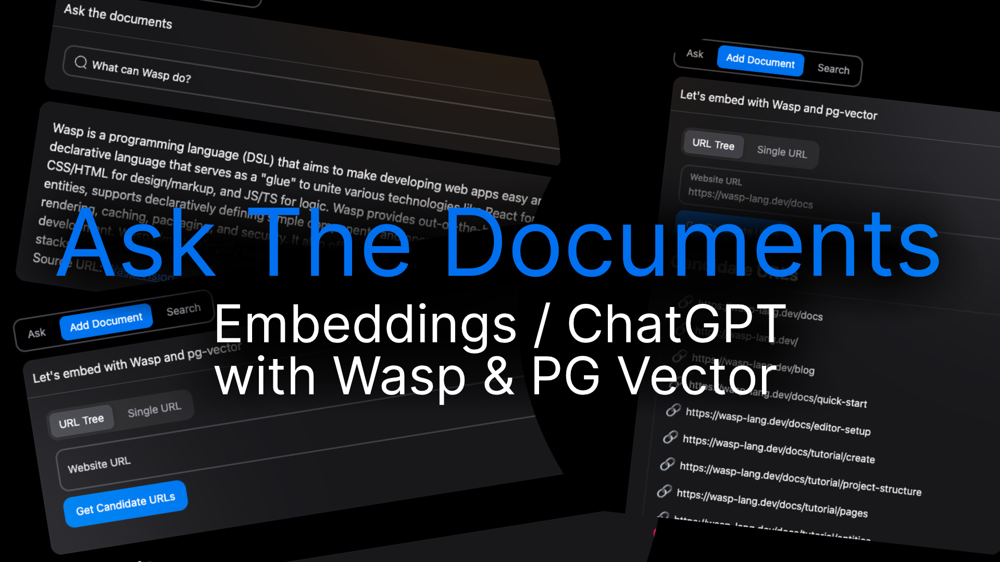

# Ask The Documents (Embeddings / RAG / ChatGPT) with Wasp & PG Vector



Live on [Fly](https://ask-the-documents-client.fly.dev/) and [Railway](https://ask-the-documents-client.up.railway.app/).

## What does it do?

This is an example Wasp app that supports:

- scraping whole link hierarchies (great for docs)
- scraping a single link
- generating embeddings for page content
- semantic search using PG Vector
- chatting with the documents using OpenAI's ChatGPT

## Running it locally

1. Install the project dependencies, which include Wasp:

   ```bash
   npm install
   ```

2. Start the database with:

   ```bash
   npm run wasp -- start db --db-image pgvector/pgvector:pg18
   ```

3. Copy `.env.server.example` to `.env.server` and fill out the environment variables.

   ```bash
   OPENAI_API_KEY="<your_openai_key>"
   GOOGLE_CLIENT_ID="<your_google_client_id>"
   GOOGLE_CLIENT_SECRET="<your_google_client_secret>"
   ```

4. Migrate the database with:

   ```bash
   npm run wasp -- db migrate-dev
   ```

5. Start the server with:

   ```bash
   npm run dev
   ```

### Installing with the development version of Wasp

In this repo, the example is part of the repo's pnpm workspace and depends on the development version of Wasp, which isn't on npm. Build Wasp from source (see [`waspc/README.md`](../../waspc/README.md)), which also installs the example's dependencies:

```sh
mise run build
```

Run the commands above with `pnpm` instead of `npm` then. To use the example outside of this repo, set `@wasp/wasp` in its `package.json` to a released Wasp version.
