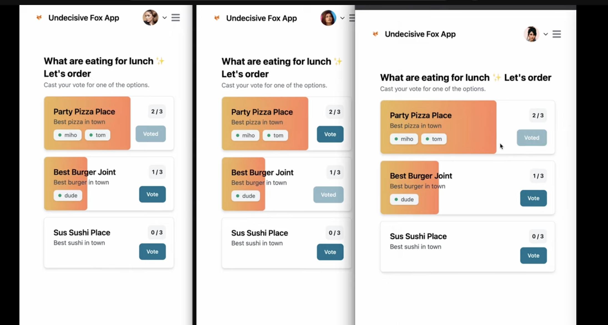

# Using Websockets in Wasp

This is an example real-time, Websockets app built with Wasp in TypeScript to showcase the ease of use and integration of Websockets in Wasp. It's really NEAT!

It is also a part of a tutorial, [How to build a real-time voting app with WebSockets, React, & Typescript](https://wasp.sh/blog/2023/08/09/build-real-time-voting-app-websockets-react-typescript).

[](https://www.youtube.com/watch?v=Twy-2P0Co6M)

You can try out a deployed version of the app here: https://websockets-voting-client.fly.dev/

This app also includes Wasp's integrated auth and a voting system (again, neat!).

## Running the app

_If you get stuck at any point, feel free to join our [Discord server](https://discord.gg/rzdnErX) and ask questions there. We are happy to help!_

First, clone the this repo:

```bash
git clone https://github.com/wasp-lang/wasp.git
```

Then navigate to the project directory, install the dependencies, which include Wasp, and migrate the DB:

```bash
cd examples/websockets-realtime-voting
npm install
npm run wasp -- db migrate-dev
```

Start the app:

```bash
npm run dev
```

Check out the `src/server/websocket.ts` and `src/client/pages/MainPage.tsx` to see how Websockets are used in Wasp.

### Installing on the `main` branch

<!-- TODO(#2262): Remove this section once the examples join the pnpm workspace. -->

On `main`, this example depends on the unreleased Wasp in this repo, so `npm install` fails. Build Wasp from source instead (see [`waspc/README.md`](../../waspc/README.md)), and then install against it from this directory:

```sh
mise run build
mise run reinstall-dev-wasp-app-deps
```

## Need Help?

Read the tutorial: [How to build a real-time voting app with WebSockets, React, & Typescript](https://wasp.sh/blog/2023/08/09/build-real-time-voting-app-websockets-react-typescript).

Wasp Docs: https://wasp.sh/docs

Feel free to join our [Discord server](https://discord.gg/rzdnErX) and ask questions there. We are happy to help!
