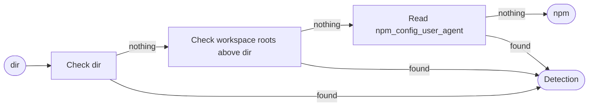
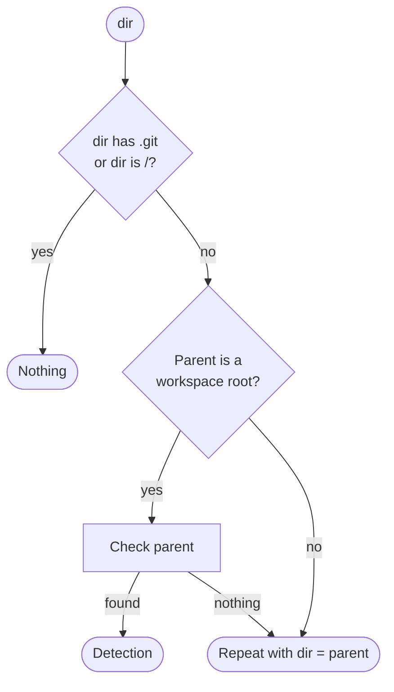

# Wasp.PackageManager

Import `Wasp.PackageManager`. The other modules are internal.

## Detection

Detects which package manager a project uses.

```haskell
detectProjectPackageManager  :: Path' Abs (Dir d) -> IO Detection
detectInvokingPackageManager :: IO Detection
```

- `detectProjectPackageManager` is for commands that run in an existing project.
- `detectInvokingPackageManager` is for scaffolding, when there are no project files yet. It only reads `npm_config_user_agent`.

### Flow



Checking the workspace roots above `dir`:



"Check" looks at one directory and stops at the first hit, in this order:

1. `packageManager` field in `package.json`
2. `devEngines.packageManager` in `package.json`
3. The files in `lockfilesAndWorkspaceFiles`, in list order
4. The files in `installMetadataFiles`, in list order

A workspace root has a `pnpm-workspace.yaml`, or a `package.json` with a `workspaces` field.

An invalid `package.json` is ignored, and the other files in its directory are still checked.

### Decisions

1. Project files win over the user agent. npm is the default when neither says anything.
2. The search goes no higher than the first directory that has `.git`.
3. Above the start dir, only workspace roots are checked.

### Drawbacks

1. Workspace membership isn't checked. An app under a workspace root gets the root's package manager even when the root's workspace globs don't include it.
