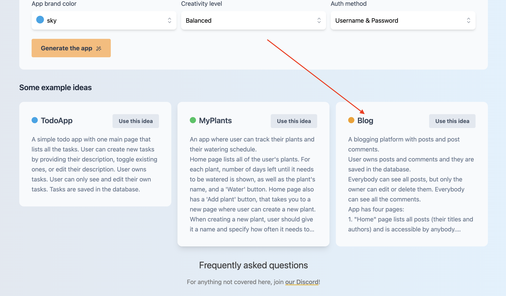
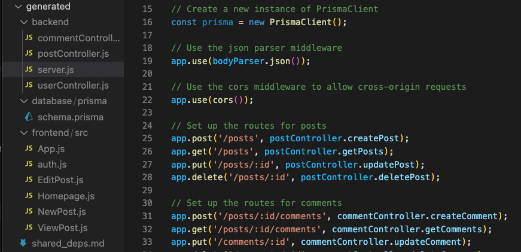

import Link from '@docusaurus/Link';

import { ImgWithCaption } from './components/ImgWithCaption';

### TL;DR

AI-assisted coding tools are on the rise. In this article, we take a deep dive into two tools that use similar techniques, but are intended for different outcomes.

[Smol AI’s “Smol-Developer”](https://github.com/smol-ai/developer) gained a lot of notoriety very quickly by being one of the first such tools on the scene. It is a simple set of python scripts that allow a user to build prototype apps using natural language in an iterative approach.

[Wasp’s “GPT Web App Generator”](https://usemage.ai/) is more of a newcomer and focuses on building more complex full-stack React + NodeJS web app prototypes through a simple prompt and fancy UI.

When comparing the two, Smol-Developer’s strength is its **versatility**. If you want to spend time tinkering and tweaking, you can do a lot to your own prompting, and even the code, in order to get decent results on a **broad range of apps**.

On the other hand, Wasp AI shines by being **specific.** Because it’s only built for generating full-stack React/NodeJS/Prisma/Tailwind codebases, it does the tweaking and advanced prompting for you, and thus it performs much better in generating **higher quality content** with less effort for a specific use case.

<ImgWithCaption source="img/blog/2023-08-01-smol-ai-vs-wasp-ai/Untitled.png" width="550px" />

Will either of these tools completely replace Junior Developers in their current form? Of course not. But they do allow for rapid prototyping and testing of novel ideas.

Read on to learn more about how they work, which tool is right for the job at hand, and how you can use them in your current workflow.

{/* truncate */}

## Intro

The age of AI-assisted coding tools is fully upon us. GitHub’s Copilot might be the go-to professional solution, but since its release numerous open-source solutions have popped up.

Most of these newer solutions tend towards functioning as an AI Agent, going beyond just suggesting the next logical pieces of code within your current file, they aim to create simple prototypes of entire apps. Some are focused more on scaffolding entire app prototypes from an initial prompt, while others function as interactive assistants, helping you modify and improve existing codebases.

Either way, they’re often being described as “AI Junior Developers”, because they can take a product requirement (i.e. “prompt”) and build a pretty good — but far from perfect — first iteration, saving developers a lot of time.

This article is going to focus on two tools that aim to build somewhat complex working prototypes from a single prompt: [Smol AI](https://github.com/smol-ai/developer) and [Wasp AI](https://usemage.ai/). We’ll test them out by running the same prompts through each and seeing what we get.

By the end of it, you’ll have a pretty good understanding of how they work, their advantages and disadvantages, and what kind of tasks they’re best suited for.

## Before We Begin

[Wasp = }](https://wasp.sh) is the only open-source, completely serverful fullstack React/Node framework with a built-in compiler and AI-assisted features that lets you build your app super quickly.

We’re working hard to help you build performant web apps as easily as possible — including creating content like this, which is released weekly!

We would be super grateful if you could help us out by starring our repo on GitHub: [https://www.github.com/wasp-lang/wasp](https://www.github.com/wasp-lang/wasp) 🙏


…&#x65;_&#x76;en Ron would star [Wasp on GitHub](https://www.github.com/wasp-lang/wasp)_ 🤩

## The Tools

### Smol-Developer

Smol AI (described as a platform for “model distillation and AI developer agents”) actually has a few open-source tools on offer, but Smol-Developer is the one we’ll be taking a look at. It was initially released by [Swyx](https://twitter.com/swyx) on May 11th and already has over 10k GitHub stars!

It aims to be a generalist, prompt-based coding assistant run from the command line. The developer’s job becomes a process of iterative prompting, testing, and re-prompting in order to get the optimal output. It is not limited to any language or type of app it can create, although simple apps tend to work best.

<ImgWithCaption source="img/blog/2023-08-01-smol-ai-vs-wasp-ai/smol-ai-tweet.png" width="400px" />

Check out this tweet thread above to get a better understanding: [https://twitter.com/swyx/status/1657892220492738560](https://twitter.com/swyx/status/1657892220492738560)

Running from the command line, Smol AI is essentially a chain of calls to the OpenAI chat completions (i.e. “ChatGpt”) endpoint via a python script that:

1. takes an initial user-generated prompt
2. creates a plan based on internal prompts\* for executing the app with:
   1. the structure of the entire app
   2. each file and its exported variables to be generated
   3. function names
3. generates file paths based on the plan
4. loops through file paths and generates code for each file based on plan and prompt

The generated output can then be evaluated by the developer and the prompt can be iterated on to account for any errors or bugs found during runtime.

Smol-Developer quickly gained notoriety by being one of the first of such tools on the scene, in addition to Swyx’s prominence within it. So if you’re curious to see what’s being built with it, just check out some of the numerous YouTube videos on it.

One of my personal favorites is AI Jason’s exposé and commentary. He gives a concise explanation, shows you some great tips on how to use Smol-Developer effectively, and as a Product Designer/Manager he gives an interesting perspective on its benefits:

<iframe width="560" height="315" src="https://www.youtube.com/embed/BMRywudsqtY" title="YouTube video player" frameborder="0" allow="accelerometer; autoplay; clipboard-write; encrypted-media; gyroscope; picture-in-picture; web-share" allowfullscreen />

- Smol-Developer GitHub Repo: [https://github.com/smol-ai/developer/](https://github.com/smol-ai/developer/)

<details>
  <summary> \*Curious to see what the internal system prompt looks like? </summary>

  ~~~
  You are a top tier AI developer who is trying to write a program that will generate code for the user based on their intent.

  Do not leave any todos, fully implement every feature requested.

  When writing code, add comments to explain what you intend to do and why it aligns with the program plan and specific instructions from the original prompt.

  In response to the user's prompt, write a plan.

  In this plan, please name and briefly describe the structure of the app we will generate, including, for each file we are generating, what variables they export, data schemas, id names of every DOM elements that javascript functions will use, message names, and function names.

  Respond only with plans following the above schema.

  the app prompt is: {prompt}
  ~~~
</details>

### Wasp’s GPT Web App Generator

In contrast to Smol-Developer, Wasp’s AI tool, [GPT Web App Generator](https://usemage.ai/), is currently an open-source web app (yes, it’s a web app that makes web apps). Since it’s release on the 12th of July, there have been over 6,500 apps generated with over 300 apps being generated each day!

<ImgWithCaption source="img/blog/2023-08-01-smol-ai-vs-wasp-ai/Untitled-1.png" width="550px" />

Here’s a quick 1 minute video showcasing how [GPT Web App Generator](https://usemage.ai/) works:

<iframe width="560" height="315" src="https://www.youtube.com/embed/u0MVsPb2MP8" title="YouTube video player" frameborder="0" allow="accelerometer; autoplay; clipboard-write; encrypted-media; gyroscope; picture-in-picture; web-share" allowfullscreen />

So to give a bit of background, [Wasp](https://wasp.sh) is actually a full-stack web app framework built around a compiler and config file. Using this approach, Wasp simplifies the web app creation process by handling boilerplate code for you, taking the core app logic written by the developer and connecting the entire stack together from frontend to backend, and database management.

It currently works with React, NodeJS, Tanstack-Query, and Prisma, taking care of features like Auth, Routing, Cron Jobs, Fullstack Typesafety, and Caching. This allows developers to focus more on the fun stuff, like the app’s features, instead of spending time on boring configurations.

Because Wasp uses a compiler and config file to generate the app from, this makes it surprisingly well suited for guiding LLMs like ChatGPT towards creating more complex apps with it, as it essentially a plan or set of instructions for how to build the app!

Take this simple example of how you’d tell Wasp that you want `username and password` authentication in your app:

```jsx
// main.wasp file

app RecipeApp {
  title: "My Recipes",
  wasp: { version: "^0.11.0" },
  auth: {
    methods: { usernameAndPassword: {} },
    onAuthFailedRedirectTo: "/login",
    userEntity: User
  }
}

entity User {=psl  // Data models are defined using Prisma Schema Language.
  id          Int        @id @default(autoincrement())
  username    String     @unique
  password    String
  recipes     Recipe[]
psl=}
```

Wasp’s config file is like an app outline that the compiler understands and can then use to connect and glue the app together, taking care of the boilerplate for you.

By leveraging the powers of Wasp, GPT Web App Generator works by:

1. taking a simple user-generated prompt via the UI
2. giving GPT a descriptive example of a Wasp app and config file via internal prompts\*
3. creating a plan that meets these requirements
4. generating the code for each part of the app according to the plan
5. checking each file for expected errors/hallucinations and fixing them

In the end, the user can download the codebase as a zipped file and run it locally. Simpler apps, such as [TodoApp](https://usemage.ai/result/07ed440a-3155-4969-b3f5-2031fb1f622f) or [MyPlants](https://usemage.ai/result/3bb5dca2-f134-4f96-89d6-0812deab6e0c) tend to work straight out of the box, while more complex apps need a bit of finessing to get working.

- Try out the GPT Web App Generator at: [https://usemage.ai/](https://usemage.ai/) or via the command line via Wasp's [experimental release](https://usemage.ai/#:~:text=%5BAdvanced%5D%20Can%20I%20use%20GPT4%20for%20the%20whole%20app%3F)
- Wasp AI / Generator GitHub: [https://github.com/wasp-lang/wasp/tree/wasp-ai/waspc/src/Wasp/AI](https://github.com/wasp-lang/wasp/tree/wasp-ai/waspc/src/Wasp/AI)

<details>
  <summary> \*Curious to see what the internal system prompt looks like? </summary>

  ````
  Wasp is a full-stack web app framework that uses React (for client), NodeJS and Prisma (for server).
  High-level of the app is described in main.wasp file (which is written in special Wasp DSL), details in JS/JSX files.
  Wasp DSL (used in main.wasp) reminds a bit of JSON, and doesn't use single quotes for strings, only double quotes. Examples will follow.

  Important Wasp features:
    - Routes and Pages: client side, Pages are written in React.
    - Queries and Actions: RPC, called from client, execute on server (nodejs).
      Queries are for fetching and should not do any mutations, Actions are for mutations.
    - Entities: central data models, defined via PSL (Prisma schema language), manipulated via Prisma.
  Typical flow: Routes point to Pages, Pages call Queries and Actions, Queries and Actions work with Entities.

  Example main.wasp (comments are explanation for you):

  ```wasp
  app todoApp {
    wasp: { version: "^0.11.1" },
    title: "ToDo App",
    auth: {
      userEntity: User,
      methods: { usernameAndPassword: {} },
      onAuthFailedRedirectTo: "/login"
    },
    client: {
      rootComponent: import { Layout } from "@client/Layout.jsx",
    },
    db: {
      prisma: {
        clientPreviewFeatures: ["extendedWhereUnique"]
      }
    },
  }

  route SignupRoute { path: "/signup", to: SignupPage }
  page SignupPage {
    component: import Signup from "@client/pages/auth/Signup.jsx"
  }

  route LoginRoute { path: "/login", to: LoginPage }
  page LoginPage {
    component: import Login from "@client/pages/auth/Login.jsx"
  }

  route DashboardRoute { path: "/", to: Dashboard }
  page DashboardPage {
    authRequired: true,
    component: import Dashboard from "@client/pages/Dashboard.jsx"
  }

  entity User {=psl
      id          Int       @id @default(autoincrement())
      username    String    @unique
      password    String
      tasks       Task[]
  psl=}

  entity Task {=psl
      id          Int       @id @default(autoincrement())
      description String
      isDone      Boolean   @default(false)
      user        User      @relation(fields: [userId], references: [id])
      userId      Int
  psl=}

  query getUser {
    fn: import { getUser } from "@server/queries.js",
    entities: [User] // Entities that this query operates on.
  }

  query getTasks {
    fn: import { getTasks } from "@server/queries.js",
    entities: [Task]
  }

  action createTask {
    fn: import { createTask } from "@server/actions.js",
    entities: [Task]
  }

  action updateTask {
    fn: import { updateTask } from "@server/actions.js",
    entities: [Task]
  }
  ```

  We are looking for a plan to build a new Wasp app (description at the end of prompt).

  Instructions you must follow while generating plan:
    - App uses username and password authentication.
    - App MUST have a 'User' entity, with following fields required:
    - `id Int @id @default(autoincrement())`
    - `username String @unique`
    - `password String`
  It is also likely to have a field that refers to some other entity that user owns, e.g. `tasks Task[]`.
    - One of the pages in the app must have a route path "/".
    - Don't generate the Login or Signup pages and routes under any circumstances. They are already generated.

  Plan is represented as JSON with the following schema:

  {
    "entities": [{ "entityName": string, "entityBodyPsl": string }],
    "actions": [{ "opName": string, "opFnPath": string, "opDesc": string }],
    "queries": [{ "opName": string, "opFnPath": string, "opDesc": string }],
    "pages": [{ "pageName": string, "componentPath": string, "routeName": string, "routePath": string, "pageDesc": string }]
  }

  Here is an example of a plan (a bit simplified, as we didn't list all of the entities/actions/queries/pages):

  {
    "entities": [{
      "entityName": "User",
      "entityBodyPsl": "  id Int @id @default(autoincrement())\n  username String @unique\n  password String\n  tasks Task[]"
    }],
    "actions": [{
      "opName": "createTask",
      "opFnPath": "@server/actions.js",
      "opDesc": "Checks that user is authenticated and if so, creates new Task belonging to them. Takes description as an argument and by default sets isDone to false. Returns created Task."
    }],
    "queries": [{
      "opName": "getTask",
      "opFnPath": "@server/queries.js",
      "opDesc": "Takes task id as an argument. Checks that user is authenticated, and if so, fetches and returns their task that has specified task id. Throws HttpError(400) if tasks exists but does not belong to them."
    }],
    "pages": [{
      "pageName": "TaskPage",
      "componentPath": "@client/pages/Task.jsx",
      "routeName: "TaskRoute",
      "routePath": "/task/:taskId",
      "pageDesc": "Diplays a Task with the specified taskId. Allows editing of the Task. Uses getTask query and createTask action.",
    }]
  }

  We will later use this plan to write main.wasp file and all the other parts of Wasp app,
  so make sure descriptions are detailed enough to guide implementing them.
  Also, mention in the descriptions of actions/queries which entities they work with,
  and in descriptions of pages mention which actions/queries they use.

  Typically, plan will have AT LEAST one query, at least one action, at least one page, and at
  least two entities. It will very likely have more than one of each, though.

  DO NOT create actions for login and logout under any circumstances. They are already included in Wasp.

  Note that we are using SQLite as a database for Prisma, so don't use scalar arrays in PSL, like `String[]`,
  as those are not supported in SQLite. You can of course normally use arrays of other models, like `Task[]`.

  Please, respond ONLY with a valid JSON that is a plan.
  There should be no other text in the response.

  ==== APP DESCRIPTION: ====

  App name: TodoApp
  A simple todo app with one main page that lists all the tasks. User can create new tasks by providing their description, toggle existing ones, or edit their description. User owns tasks. User can only see and edit their own tasks. Tasks are saved in the database.
  ````
</details>

## Comparison Test

### Prompt 1: PONG Game

To get a sense for how each coding agent performed, I tried out two different prompts on both Smol-Developer and Wasp’s GPT Web App Generator with only slight modifications to the prompts to fit the requirements of each tool.

The first prompt was the default prompt that comes hardcoded into Smol-Developer’s `[main.py](http://main.py)` script:

> _a simple JavaScript/HTML/CSS/Canvas app that is a one player game of PONG. The left paddle is controlled by the player, following where the mouse goes. The right paddle is controlled by a simple AI algorithm, which slowly moves the paddle toward the ball at every frame, with some probability of error. Make the canvas a 400 x 400 black square and center it in the app. Make the paddles 100px long, yellow and the ball small and red. Make sure to render the paddles and name them so they can controlled in javascript. Implement the collision detection and scoring as well. Every time the ball bounces off a paddle, the ball should move faster._

:::note
💡 For Wasp’s GPT Web App Generator, I replaced the first line with “a simple one player game of PONG” since Wasp will automatically generate a full-stack React/NodeJS app.

:::

Both were able to create a functional PONG game out-of-the box, but only on the second try. The first try created decent PONG starters, but both had buggy game logic (e.g. computer opponent failed to hit ball, or ball would spin off into oblivion). I didn’t change the prompts at all, but just simply ran them a second time each — and that did the trick!

<ImgWithCaption source="img/blog/2023-08-01-smol-ai-vs-wasp-ai/Untitled-2.png" width="400px" caption="Smol AI’s PONG game" />

<ImgWithCaption source="img/blog/2023-08-01-smol-ai-vs-wasp-ai/Untitled-3.png" width="400px" caption="Wasp AI’s PONG game" />

For both of the generated apps, the game logic was very simple. Scores weren’t recorded, and once a game ended, you’d have to refresh the page to start a new one.

Although, while Smol-Developer only created the game logic, GPT Web App Generator created the game logic as well as the logic for authentication, creating games, and updating a game’s score, saving it all to the database (though the scoring functions weren’t being utilized initially).

To be fair, this isn’t really a surprise though as these features are baked into the design of Wasp and the Generator.

On the other hand, to get these same features for Smol-Developer, we’d have to elaborate on our prompt, giving it explicit instructions to implement them, and iterate on it a number of times before landing on an acceptable prototype.

This is what I attempted to test out with the second prompt.

### Prompt 2: Blog App



This time, for the second app test, I used a default prompt featured on the GPT Web App Generator homepage for creating a Blog app:

> A blogging platform with posts and post comments.
> User owns posts and comments and they are saved in the database.
> Everybody can see all posts, but only the owner can edit or delete them. Everybody can see all the comments.
> App has four pages:
>
> 1. "Home" page lists all posts (their titles and authors) and is accessible by anybody.
>    If you click on a post, you are taken to the "View post" page.
>    It also has a 'New post' button, that only logged in users can see, and that takes you to the "New post" page.
> 2. "New post" page is accessible only by the logged in users. It has a form for creating a new post (title, content).
> 3. "Edit post" page is accessible only by the post owner. It has a form for editing the post with the id specified in the url.
> 4. "View post" page is accessible by anybody and it shows the details of the post with the id specified in the url: its title, author, content and comments.
>    It also has a form for creating a new comment, that is accessible only by the logged in users.

:::note
💡 For the Smol-Developer prompt, I added the lines: “The app consists of a React client and a NodeJS server. Posts are saved in an sqlite database using Prisma ORM.”
:::

<iframe width="560" height="315" src="https://www.youtube.com/embed/8A_i5L9MJ90" title="YouTube video player" frameborder="0" allow="accelerometer; autoplay; clipboard-write; encrypted-media; gyroscope; picture-in-picture; web-share" allowfullscreen />

As this was a suggested prompt on the GPT Web App Generator page, let’s start with the Wasp app result first.

After downloading the generated codebase and running the app, I ran into an error `Failed to resolve import "./ext-src/ViewPost.jsx" from "src/router.jsx". Does the file exist?`

<ImgWithCaption source="img/blog/2023-08-01-smol-ai-vs-wasp-ai/Untitled-5.png" width="550px" />

One quick look at the `main.wasp` file revealed that the Generator gave the wrong path to the `ViewPost` page, although it did get all the other Page paths correct (highlighted in yellow above).

Once that path was corrected, a working app popped up at localhost:3000. Nice!

<iframe width="560" height="315" src="https://www.youtube.com/embed/c8JacesyTe8" title="YouTube video player" frameborder="0" allow="accelerometer; autoplay; clipboard-write; encrypted-media; gyroscope; picture-in-picture; web-share" allowfullscreen />

The video above was my first time trying out the app, and as you can see, most of the functionality is there and working correctly — Authentication and Authorization, and basic CRUD operations. Pretty amazing!

There were still a couple of errors that prevented the app from being fully functional out-of-the-box, but they were easy to fix:

1. Blog posts on the homepage did not have a link in order to redirect to the their specific post page — fixable by just wrapping them in ``<Link to={`/post/${post.id}`}>``
2. The client was passing the `postId` as a String instead of an `Int` to the `getPost` endpoint — fixable by wrapping the argument in `parseInt(postId)` to convert strings to integers

<ImgWithCaption source="img/blog/2023-08-01-smol-ai-vs-wasp-ai/Untitled-6.png" width="400px" />

And with those simple fixes we got a fully functioning, full-stack blog app with authentication,  database, and simple tailwind css styling! The best part was that all this took about ~5 minutes from start to finish. Sweet :)

:::note
🧑‍💻 The Generator saves all the apps it creates along with a sharable link, so if you want to check out the original generated Blog app code (before fixes) from above, click here: [https://usemage.ai/result/a3a76887-952b-4774-a773-42209c4bffa8](https://usemage.ai/result/a3a76887-952b-4774-a773-42209c4bffa8)

:::

<iframe width="560" height="315" src="https://www.youtube.com/embed/oT0pCbN-JgE?start=50" title="YouTube video player" frameborder="0" allow="accelerometer; autoplay; clipboard-write; encrypted-media; gyroscope; picture-in-picture; web-share" allowfullscreen />

The Smol-Developer result was also very impressive, with a solid ExpressJS server and a lot of React client pages, but there were too many complicated errors that prevented me from getting the app started, including but not limited to:

1. No build tools or configuration files
2. The server was importing database models that didn’t exist
3. The server was importing but not utilizing Prisma as the ORM to communicate with the DB
4. Client had Auth logic, but was not utilizing it to protect pages/routes



Because there were too many fundamental issues with the app, I went ahead and added some more lines to the bottom of the prompt:

> …
>
> Scaffold the app to be able to use Vite as the client's build tool. Include a package.json file >with the dependencies and scripts for running the client and server.

This second attempt produced some of the changes I was looking for, like package.json files and Vite config files to bootstrap the React app, but it still **failed** to include:

1. An index.html file
2. Package.json files with the correct dependencies being imported from within the client and server
3. A `prisma.schema` file
4. A css file (although it did include `classNames` in the jsx code)

On the other hand, the server code, albeit much sparser this time, did at least import and use Prisma correctly.

So I went ahead for a third attempt and modified and added the following lines to the bottom of the prompt:

> …
>
> Scaffold the app to be able to use Vite as the client's build tool.
>
> Make sure to include the following:
>
> 1. package.json files for both the server and client. Make sure that these files include the >dependencies being imported in the respective apps.
> 2. an index.html file in the client's public folder, so that Vite can build the app.
> 3. a `prisma.schema` file with the models and their fields. Make sure these are the same models >being used app-wide.
> 4. a css file with styles that match the `className`s used in the app.

With these additions to the prompt, the third iteration of the app did in fact include them! Well, most of them, but unfortunately not all of them. Now I was getting the css and package.json files, but no vite config file was created this time, even though the instructions for using “Vite as the client’s build tool” produced one previously.

Besides that, no auth logic was implemented, imports were out place or missing, and an `index.jsx` file was also nowhere to be found, so I decided to stop there.

<ImgWithCaption source="img/blog/2023-08-01-smol-ai-vs-wasp-ai/Untitled-8.png" width="400px" />

I’m sure I could have iterated on the prompt enough times until I got closer to a working app, but at ~$0.80-$1.20 a generation, I didn’t feel like racking up more of an OpenAI bill.

:::note
💸 Price per generation is another big difference between the Smol AI and Wasp AI. Because more work is being done by Wasp’s compiler and less by GPT, each app costs about ~$0.10-$0.20 to generate (although Wasp covers the cost and allows you to use it for free), whereas to generate [complex full-stack apps with Smol-Developer can cost upwards of ~$10.00](https://www.youtube.com/watch?v=zsxyqz6SYp8)!

:::

Plus, there are plenty of YouTubers who’ve created videos about the process of using Smol-Developer and it seems they all come to similar conclusions: you need to create a very detailed and explicit prompt in order to get a working prototype (In fact, in AI Jason’s Smol-AI video above, he mentioned that he got the best results out of the box when prompting Smol-Developer to write everything to one file only — of course this limits you to generating simple apps only that are not so easy to continue from manually).

## Thoughts & Further Considerations

At their core, SmolAI and WaspAI function quite similarly, by first prompting the LLM to create a plan for the app’s architecture, and then to execute on that plan, file by file.

But because Smol-Developer aims to be able to generate a wider range of apps, the expectation is on the Developer (or “Prompt Engineer”) to create a highly detailed, explicit prompt, which is more akin to a Product Requirement Doc that a Product Designer would write. This can take a few iterations to get right and pushes Smol-Developer in the direction of “Natural Language Programming” tool.

On the other hand, Wasp’s GPT Web App Generator has a lot of prompting and programming going on behind the scenes, abstracted away from the user and hidden within the Generator’s code and Wasp’s compiler. Wasp comes with a lot of knowledge baked in and already has a good idea of what it wants to build, which means the user has less to think about it. This means that we’re more likely to get a working complex prototype from a short, simple prompt, but we have less flexibility in the kinds of apps we’re able to create — we always get a full-stack web app.

In general, Wasp is like a junior developer specialized in web dev and has a lot of experience with a specific stack, while Smol AI is a junior developer that’s a generalist who is more versatile, but has less specific knowledge and experience with web dev 🙂

|  | Smol AI  | Wasp AI |
| --- | --- | --- |
| 🧑‍💻 Types of Apps  | Varied  | Full-stack Web Apps |
| 🗯 Programming Languages  | All Types | JavaScript/TypeScript |
| 📈 Complexity of Generated App  | Simple to Medium | Medium to Complex |
| 💰 Price per Generation — via OpenAI’s API | $0.80 to $10.00 | $0.10 to $0.20 |
| 💳 Payment Method | bring your own API key  | free — paid for by Wasp  |
| 🐛 Debugging  | Yes, if you’re willing to tinker | Built-in, but limited |
| 🗣 Type of Prompt Needed  | Complex and detailed, 1 or more pages (e.g. an entire Product Requirement Doc) | Simple, 1-3 paragraphs |
| 😎 Intended User  | Engineers, Product Designers wanting to generate a broad range of simple prototypes | Web Devs, Product Designers that want a feature rich full-stack web app prototype  |

Other big differences lie within:

1. Error Correction upon Code Creation
   1. Smol AI initially had a debugging script, but this has temporarily deprecated due to the fact that it expects the entire codebase when debugging, and current 32k and 100k token context windows are only available in private beta for GPT4 and Anthropic at the moment.
   2. Wasp AI has some error correction baked into its process, as the structure of a Wasp app is more defined and the range of errors are more predictable.
2. Price per app generation via OpenAI’s chat completion endpoints
   1. Smol AI can cost anywhere from **~$0.80 to $10.00** [depending on the complexity of the app](https://www.youtube.com/watch?v=zsxyqz6SYp8).
   2. Wasp AI costs ~**$0.10 to $0.20** per app, when using the default mix of GPT 4 and GPT 3.5 turbo, but Wasp covers the bill here. If you choose to run [it just with GPT4](https://usemage.ai/#:~:text=%5B-,Advanced,-%5D%20Can%20I%20use), then the cost is 10x at **$1.00 to $2.00** per generation and you have to provide your own API key.
3. User Interface
   1. Smol Developer works through the command line and has minimal logging and process feedback
   2. Wasp AI currently uses a clean web app UI with more logging and feedback, as well as through the command line without a UI (you have to download the [experimental Wasp release](https://usemage.ai/#:~:text=%5BAdvanced%5D%20Can%20I%20use%20GPT4%20for%20the%20whole%20app%3F) to do so at this time).

Overall, both solutions produce amazing results, allowing solo developers or teams iterate on ideas and generate prototypes faster than before. But they still have a lot of room for improvement.

For example, what these tools lack the most at the moment is in interactive debugging and incremental generation. It would be great if they could allow the user to generate additional code and fix problems in the codebase on the fly, rather than having to go back, rewrite the prompt, and regenerate an entire new codebase.

I’m not aware of the Smol AI roadmap, but seeing that it’s received a grant from [Vercel’s AI accelerator program,](https://vercel.com/blog/ai-accelerator-participants) I’m sure we will be seeing development on it continue and the tool improve (let me know in the comments if you do have some insight here).

On the other hand, as I’m a member of the Wasp team, I can confidently say that Wasp will soon be adding the initial generation process and interactive debugging into Wasp’s command line interface!

So I definitely think it’s early days and that these tools will continue to progress — and continue to produce more impressive results 🚀

## Which Tool Should You Use?

Obviously, there can be no clear winner here as the answer to question of which tool you should use as your next “AI Junior Developer” depends largely on your goals.

Are you looking for a tool that can generate a broad range of simple apps? And are you interested in learning more about building AI-assisted coding tools and natural language programming and don’t mind tweaking and tinkering for a while? Well then, [Smol-Developer](https://github.com/smol-ai/developer) is what you’re looking for!

Do you want to generate a working full-stack React/Node app prototype with all the bells and whistles as quickly and easily as possible? Head straight for Wasp’s [GPT Web App Generator](https://usemage.ai/)!

:::info Help me help you
🌟 **If you haven’t yet, please** [star us on GitHub](https://www.github.com/wasp-lang/wasp), especially if you found this useful! If you do, it helps support us in creating more content like this. And if you don’t… well, we will deal with it, I guess.


:::

In general, as Jason “AI Jason” Zhou said:

> “_I’m really excited about \[AI-assisted coding tools] because if I want to user-test a certain product idea I can ask it to build a prototype very, very quickly, and test with real users”_

Jason makes a great point here, that these tools don’t really have the capacity to replace Junior Developers entirely in their current capacity (although they will surely improve in the future), but they do improve the speed and ease with which we can try out novel ideas!

I personally believe that in the near future we will see more domain-specific AI-assisted tools like Wasp’s [GPT Web App Generator](https://usemage.ai) because of the performance gains they bring to the end user. Code agents that are focused on a niche can produce better results out of the box due to the embedded knowledge. In the future, I think we can expect a lot of agents that are each tailored towards fulfilling a specific task.

But don’t just take my word for it. Go ahead try out [Smol-Developer](https://github.com/smol-ai/developer) and the [GPT Web App Generator](https://usemage.ai) for yourself and let me know what you think in the comments!
